# Student B – Evidence

This document records the requested Git evidence for Student B. Screenshots are stored in the `images/` subfolder and are referenced below.

## E1 – SSH Remote Configuration

**Command:**

```bash
git remote -v
```

The `origin` remote uses the SSH URL `git@github.com:omarabushanab/lantern.git` for fetch and push.

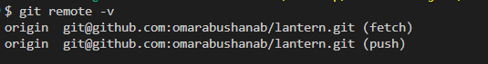

**Supporting: SSH authentication test**

```bash
ssh -T git@github.com
```

The SSH test successfully authenticated as `Ha29la10`.

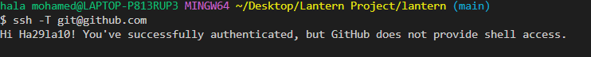

**Supporting: SSH key generation**

```bash
ssh-keygen -t ed25519
```

An ED25519 SSH key pair was created.

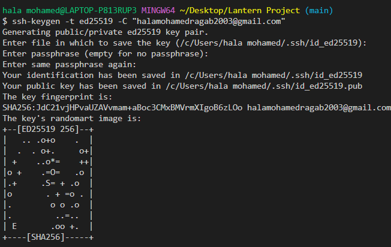

## E3 – Commit and Tree Object Inspection

### Commit 1

- **Commit SHA:** `3566945462f7935d85e73ed0686b40267a1dc509` (`feat(storage): add JSON persistence`)
- **Root tree SHA:** `3831bf2aa5db8a8df67007816e33176adacfcc85`

### Commit 2

- **Commit SHA:** `49cc97adb3d37a6b363e1769e84b6344700debcc` (merge commit)
- **Root tree SHA:** `b22d94adfcf58bbff2976291d7461f213b237c15`

**Command:**

```bash
git show -s --format="commit: %H%ntree: %T" 3566945 49cc97a
```

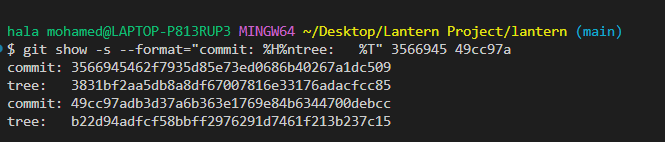

### Identical file and different file

- **Identical file:** `stoarge.py` – same hash, same object in both commits.
- **Different file:** `README.md` – different hash, different object.

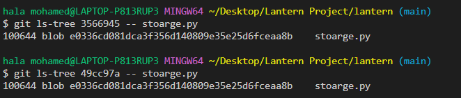

The following commands show that `stoarge.py` has an identical blob SHA in both commits:

```bash
git ls-tree 3566945 -- stoarge.py
git ls-tree 49cc97a -- stoarge.py
```

The following commands show that `README.md` has a different blob SHA:

```bash
git ls-tree 3566945 -- README.md
git ls-tree 49cc97a -- README.md
```

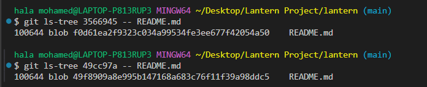

## E4 – Branch and Merge History

**Command:**

```bash
git log --graph --oneline --decorate --all
```

The recorded history shows the project history from the initial commit `f14aeaa` to `HEAD` at `46ea2e0`, including feature branches and pull requests #7 through #10.

```text
*   46ea2e0 (HEAD -> main, origin/main, origin/HEAD, myfork/main) Merge pull request #10 from Ha29la10/docs/contributing
|\
| * 82c1a71 (myfork/docs/contributing, docs/contributing) docs(contributing): add contribution guidelines
|/
*   d34b507 Merge pull request #9 from omarabushanab/feature/export-csv
|\
| *   35e38e2 Merge branch 'feature/export-csv' of https://github.com/omarabushanab/lantern into feature/export-csv
| |\
| | *   94d6d4e Merge branch 'main' into feature/export-csv
| | |\
| |_|/
|/| |
| | * a9e4904 (origin/feature/export-csv) chore(export): handle exporting csv
| * | 4af6910 chore(export): handle exporting csv
|/ /
* |   16a4b0a Merge pull request #8 from omarabushanab/feature/list-sort
|\ \
| |/
|/|
| * 10baf1b (origin/feature/list-sort) Add comment to the add command parser
| *   7a46fdc (feature/list-sort) merge(list): combine done and sort options
| |\
| |/
|/|
* |   6e1c66a Merge pull request #7 from omarabushanab/feature/list-done
|\ \
| * | be1a4cc (origin/feature/list-done) refactor(lantern): reformat code
| * | 173618d fix(lantern.py): add the list
|/ /
* | 66628bc fix(cli): handle empty task lists (#4)
| * b35745e feat(cli): add list sort option
|/
| * a4d1be3 (origin/fix/empty-list-message, fix/empty-list-message) fix(cli): handle empty task lists
|/
*   4d443b0 Merge branch 'docs/usage-heading'
|\
| * c998b53 (docs/usage-heading) docs(usage): add usage heading
* | fd77d76 (tag: v0.1.0) Revert "docs(usage): document remove command"
* | 18b3dac docs(usage): document remove command
|/
*   edebd5b Merge branch 'main' of https://github.com/omarabushanab/lantern
|\
| * 3ca90b7 chore(git): ignore generated files
| * 9fd9d6a chore(git): stop tracking generated files
| * 7b2596a chore(git): track generated files
* | 5f777e7 feat(notes.txt): add second line
|/
*   491bb74 Merge branch 'main' of https://github.com/omarabushanab/lantern
|\
| * 991a0dc fix(git): ignore generated files
| * 9a21d75 chore(repo): add generated files by mistake
| *   5cf928f merge(storage): combine JSON formatting options
| |\
| | * ff50a40 feat(storage): format JSON output
| * | 6130e02 fix(storage): sort JSON keys
| |/
* | 475e33d feat(notes.txt): this message has no typo
* | d9ff78d fix(gitignore): fix file format from utf-16 to utf-8 for git to be able to read
* | e9bff65 fix(gitignore): ignore .env
|/
* 3ea1fae fix(env): untrack env file
* 38824e6 feat(env): add secret key
*   193cb87 Merge branch 'feature/done-flag'
|\
| * dd096a1 feat(tasks.py): add done flag in task
* | 2c0ae22 fix(tasks.py): clean title task
|/
*   cdf554f Merge branch 'main' of https://github.com/omarabushanab/Lantern
|\
| * 48a1874 chore(git): remove scratch file
| * e6993de test(git): add temporary scratch file
| * 84b36ef docs: add usage guide
| *   49cc97a Merge branch 'main' of github.com:omarabushanab/lantern
| |\
| * | 3566945 feat(storage): add JSON persistence
* | | 69bc885 feat(lantern.py): add argument handler
* | | ba8a2b5 fix(drafts.txt): rename drafts.txt to notes.txt
* | | bda8841 feat(drafts.txt): add a drafts placeholder file
* | | b4ca910 feat(lantern.py): add command line entry point
* | | 7ff26de feat(tasks): add task function
| |/
|/|
* | 596eabf resolve(readme): merge both names in table
|\|
| * 24791bb docs(readme): add student B to team
* | c7e8de2 docs(readme): add member details
|/
* f14aeaa Initial commit
```

**Supporting: the merges shown in the graph**

The document also records these merge exercises:

- `git merge fix/stable-key-order` – fast-forward.
- `git merge feature/pretty-json` – merge conflict in `stoarge.py`.
- Conflict resolved in merge commit `5cf928f`; feature branches deleted and changes pushed to `origin/main`.

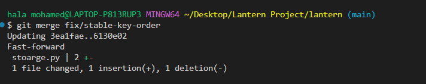

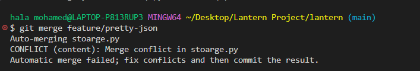

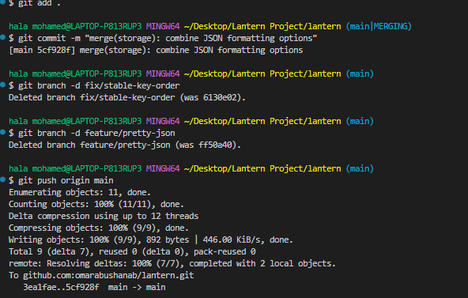

## E5 – Drill (b): Wrong Branch

**Command:**

```bash
git reflog --date=local
```

### Summary

- **Original accidental commit on `main`:** `24d4b7b`
- **Recovery branch:** `docs/usage-heading`
- **Recovered commit (cherry-pick):** `c998b53`
- **Final merge commit:** `4d443b0`
- Local `main` was reset to `origin/main`; the recovery branch was then merged into `main` and pushed.

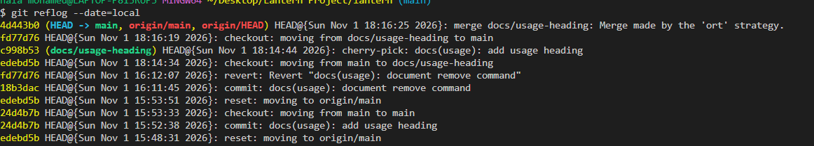

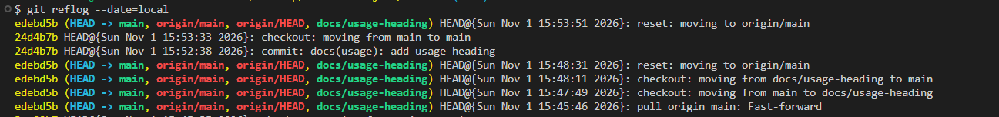

**Final history:**

```bash
git log --oneline --graph --decorate -8
```

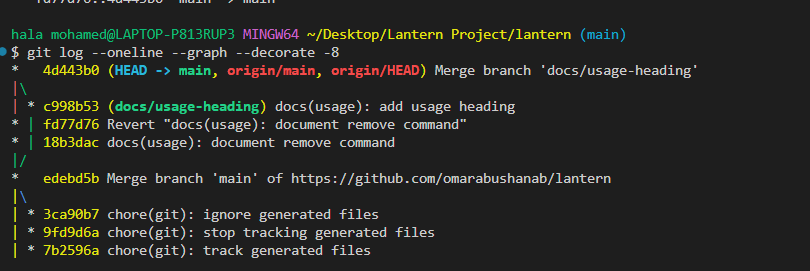

## E6 – Stash Evidence

**Command:**

```bash
git stash list
```

The stash was created with:

```bash
git stash push -m "WIP: list sort option"
```

The stash list showed:

```text
stash@{0}: On feature/list-sort: WIP: list sort option
```

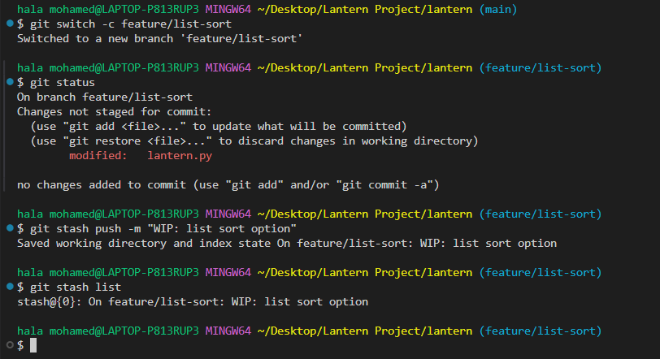
